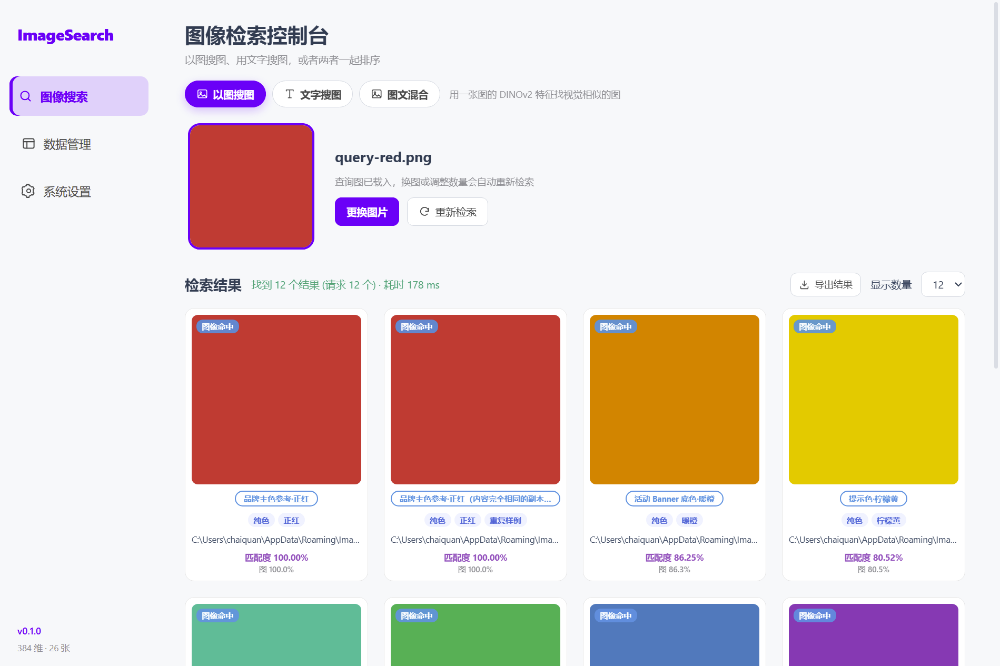
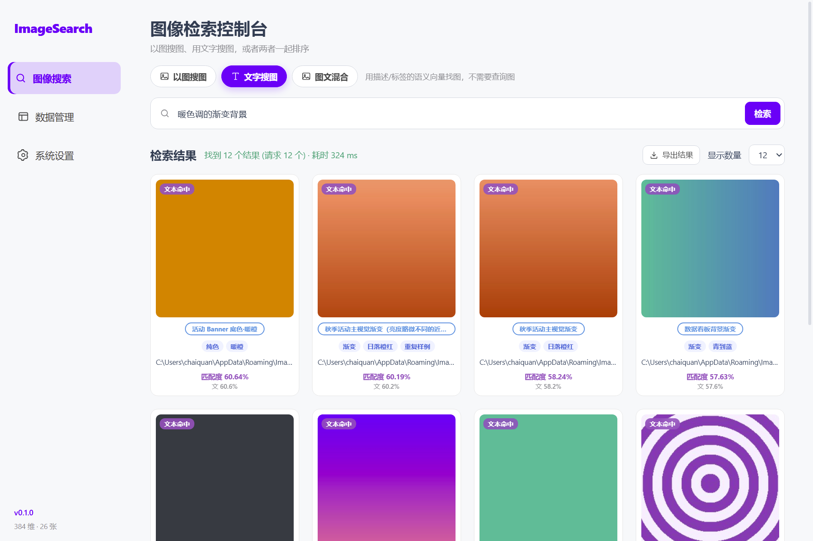
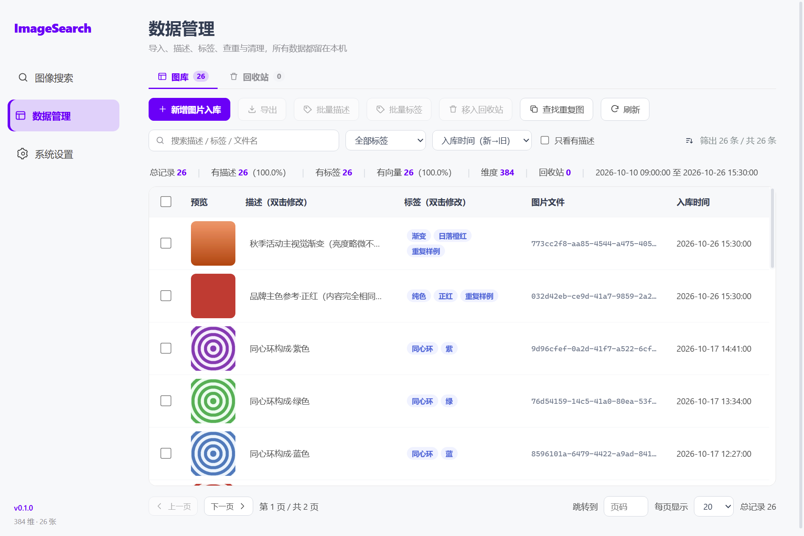
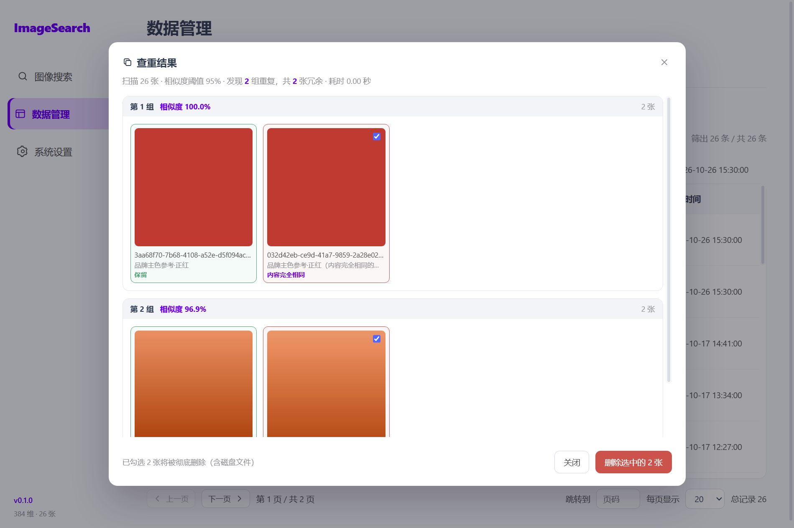
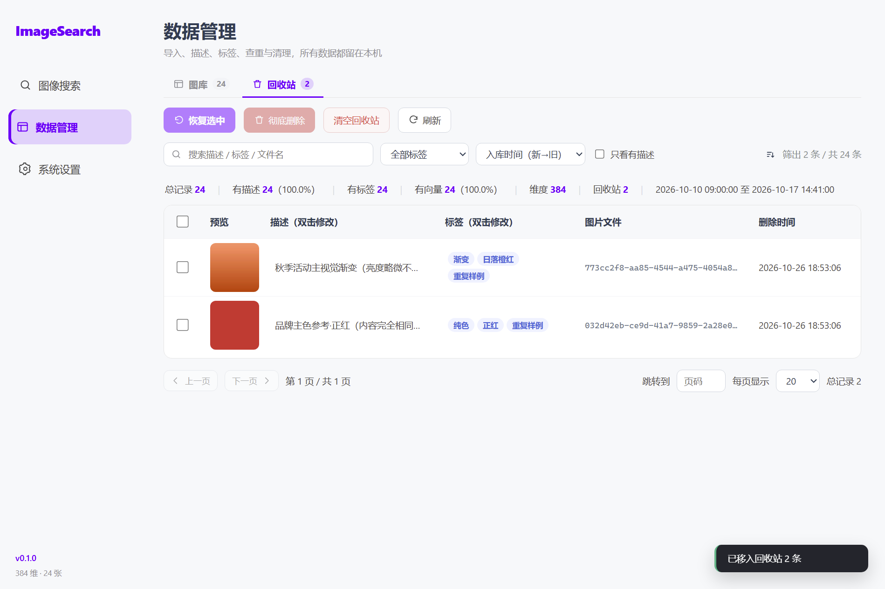
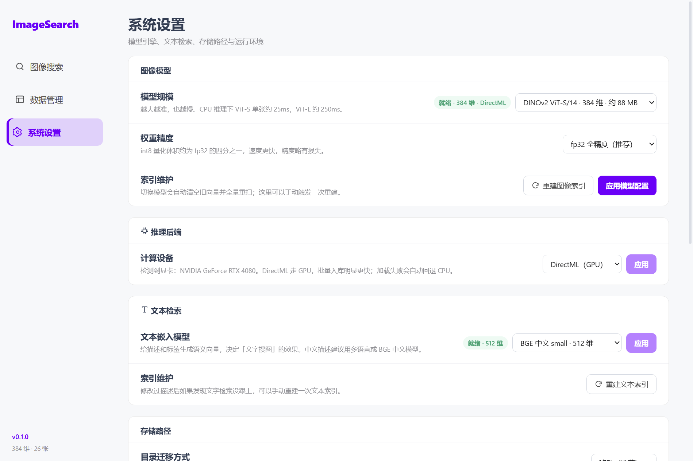

# ImageSearch

一个纯本地的图像检索与图库管理桌面客户端：入库即抽特征，**以图搜图**、**用文字搜图**，
或者两者一起排序；重复图、标签、回收站、导出都是内置的。

- 特征提取：**DINOv2**（transformers.js + ONNX Runtime，纯 JS，无需 Python / PyTorch）
- 文本检索：**BGE 中文 / 多语言 MiniLM**（同一套 ONNX 运行时，懒加载）
- 向量检索：**TypeScript 暴力 Top-K**（连续 Float32Array，取代 FAISS）
- 数据存储：**SQLite**（node-sqlite3-wasm，无需本地编译）
- 推理后端：**CPU / DirectML（Windows 显卡加速）**，失败自动回退
- 桌面壳：**Electron 45 + React 19 + Vite**

## 界面













## 技术对照

本项目由最初的 **PyQt5 + Python** 版重写而来，能力一一对应：

| 能力 | 原实现 | 现实现 |
| --- | --- | --- |
| 桌面界面 | PyQt5 + QSS | Electron + React + CSS |
| 特征提取 | `torch.hub` DINOv2 + PyTorch | `@huggingface/transformers` + ONNX Runtime |
| 文本检索 | 无（描述只存不用） | 独立文本嵌入模型 + 语义向量检索 |
| 模型权重 | `.pth` 手动下载 | 自动从镜像拉 ONNX，缓存复用 |
| 向量检索 | FAISS `IndexFlatL2` + `IndexIDMap` | 连续 `Float32Array` + 插入式 Top-K |
| 数据库 | `sqlite3`（Python 内置） | `node-sqlite3-wasm` |
| 图像处理 | Pillow | 模型自带的 `RawImage` / image processor + `nativeImage` |
| 打包 | PyInstaller | electron-builder（NSIS） |

## 快速开始

```bash
npm install          # 无原生模块，不需要 VS Build Tools
npm run dev          # 开发模式（热更新）
```

生产构建：

```bash
npm run build        # 编译 main / preload / renderer 到 out/
npm start            # 用编译产物启动
npm run dist         # 打 Windows 安装包到 release/
```

首次启动会从 `hf-mirror.com` 下载 DINOv2 ViT-S/14 的 ONNX（约 88 MB），之后走本地缓存。
文本模型是**懒加载**的：第一次用文字检索时才下载（BGE 中文 int8 约 25 MB）。
镜像地址可以在设置页改，或直接改 `settings.json` 里的 `hfMirror`。

## 功能

### 检索（三种模式）

| 模式 | 说明 |
| --- | --- |
| 以图搜图 | 上传/拖入一张图，用 DINOv2 特征做全库 L2 检索 |
| 文字搜图 | 用描述/标签的语义向量检索，不需要查询图 |
| 图文混合 | 两路通道一起排序，结果标注命中来源（图像 / 文本 / 双命中） |

- 匹配度：图像通道沿用 `1 / (1 + distance)`；文本通道是余弦相似度；
  双命中在较高分基础上再加 5% 的小幅加成，单通道就取该通道值
- 文字检索还会走路**字面通道**（描述 / 标签 / 文件名精确包含），避免语义漂移漏掉全等匹配
- 卡片显示「匹配度 86.25%（图 86.3%）」这样的拆解，能看出是哪个通道命中的
- 显示数量 6 / 12 / 24 / 36 / 48，切换自动重搜；点图开大图，可直达文件夹
- 结果可一键导出（含 `metadata.csv`）

### 数据管理

- 批量导入：算哈希查重 → 复制到托管目录（uuid 重命名）→ 抽特征 → 入库 → 实时进索引
- **导入去重**：内容完全相同（复制过的同一张图）直接跳过，导入结果里单独报出跳过数
- 分页表格（10 / 20 / 50 / 100、页码跳转），表头吸顶，缩略图按需原生生成
- 双击描述 / 标签即改即存；勾选后可批量写描述、批量打标签（追加或覆盖）
- **标签体系**：逗号分隔存储，点击标签即可按它筛选，下拉框按使用次数排序
- **筛选与排序**：关键词（描述/标签/文件名）+ 标签 + 只看有描述；按时间正逆序、描述、文件大小排序
- **回收站**：删除先进回收站（文件保留），可恢复、可彻底删除、可一键清空
- **查重**：8×8 感知签名两两比对，自动分组，默认保留最早的、其余勾选待删
- 统计条：总数、有描述率、有标签数、有向量率、维度、回收站条数、时间范围

### 系统设置

- 图像模型：ViT-S / ViT-B / ViT-L（384 / 768 / 1024 维），fp32 / int8
- 推理后端：CPU / **DirectML（GPU）**，检测到显卡时默认走 GPU，加载失败自动回退 CPU
- 文本模型：BGE 中文（默认，排序最准）/ 多语言 MiniLM（中英混排）/ 英文 MiniLM
- 切换图像模型自动清空旧向量并全量重扫；文本模型切换只重建描述向量
- 图像 / 文本索引都可手动重建
- 目录迁移：**移动**（默认，同盘瞬时改名，跨盘复制后删源）或**复制**（保守，保留源目录）
- 迁移图片目录会同步改写数据库里的路径前缀；迁移数据库前会先断开连接确保落盘
- 导入去重开关、运行环境信息、一键打开数据目录

## 数据位置

Windows：`%APPDATA%\ImageSearch`（开发版与安装版共用同一目录）

```
settings.json           # 配置
data/
├─ models/              # 图像与文本模型的 ONNX 缓存
├─ images/              # 托管图片
└─ database/image.db    # 元数据 + 向量 BLOB + 签名
```

所有数据都在本地，不联网也能检索（仅首次下载模型需要网络）。

## 命令行参数

```bash
ImageSearch.exe --query "D:\pics\a.jpg"          # 启动即用该图检索
ImageSearch.exe --route=library                   # 启动进指定页（search/library/settings）
ImageSearch.exe --screenshot=out.png --delay=3000 # 自动截图后退出（调试用）
```

## 校验

```bash
npm run verify    # 45 项核心逻辑断言（见下）
npm run seed      # 生成 26 张演示图 + 2 组重复样例并写入当前数据目录（会清空现有图库）
```

`npm run verify` 覆盖：

- **向量索引**：排序、Top-K 截断、删除（末尾交换）、重复 id 覆盖、扩容、维度校验
- **路径前缀改写**：只改本目录下的记录、分隔符正确、`_` / `%` 不被当 LIKE 通配符、同目录不动
- **查重签名**：长度固定、同图缩放不变、亮度微调仍判重、不同颜色不误判、长度不一致返回 0
- **标签解析**：去空白去空项、大小写去重、清理非法字符
- **真实数据库**：老库自动补列不丢数据、哈希命中、标签/关键词/描述筛选、软删除与恢复、
  统计口径、排序、批量追加标签、彻底删除、清空回收站
- **目录迁移**：移动清空源目录、内容完整、复制保留源、拒绝子目录、源不存在报错

端到端（需要应用带 `--remote-debugging-port` 启动，驱动真实 IPC）：

```bash
CDP_PORT=9223 npm run e2e
```

覆盖 32 项：三页数据读写、三种检索模式、导入去重、标签增改、描述→文本向量联动、
回收站全流程、查重、导出、目录移动迁移与回滚。

## 相对 Python 版修掉的问题

- 运行期改图片存储目录后，新导入的图仍写进旧目录（原版 `db_page.py` 在模块顶层 import 了路径快照）
- 切到 `vitl14` / `vitg14` 时下载链接为空导致崩溃（原版只有 s14/b14 配了 URL）
- 检索在主线程同步跑推理，界面假死（现在推理在 main 进程，渲染层完全异步）
- 缩略图画布 160×160 但容器高 150，图片被裁
- 启动闪屏图缺失导致显示灰块
- 路径前缀改写把 `_` / `%` 当 LIKE 通配符，可能误改前缀相似的目录

## 两个技术取舍

**查重不用 DINOv2 向量，用 8×8 感知签名。**
DINOv2 的 CLS 特征是语义表达，两张构图相同但内容不同的图（正红 vs 暖橙纯色）
余弦相似度也能到 0.98，会把它们判成重复；而真正被重新压缩、缩放过、亮度微调过的
同一张图，8×8 平均色几乎不变。所以「重复」看像素签名，「相似」才用向量。

**文本模型统一 int8。**
这几款小模型量化后检索质量几乎无损（BGE 中文在「暖色调的渐变背景」这类查询上，
int8 与 fp32 的首位命中一致），但体积只有四分之一，首次下载和 CPU 推理都轻松得多。
