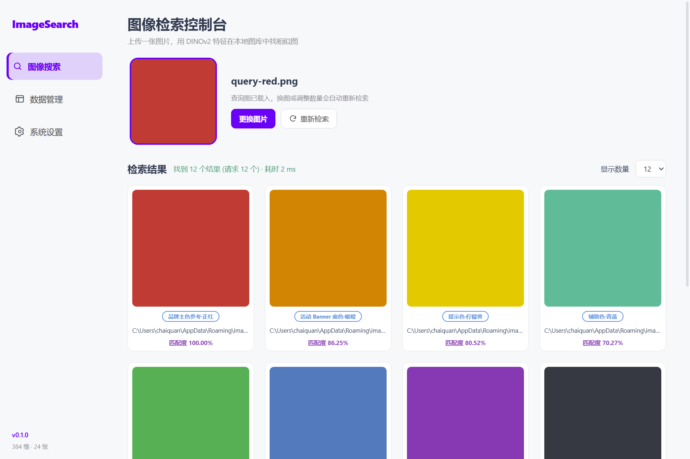
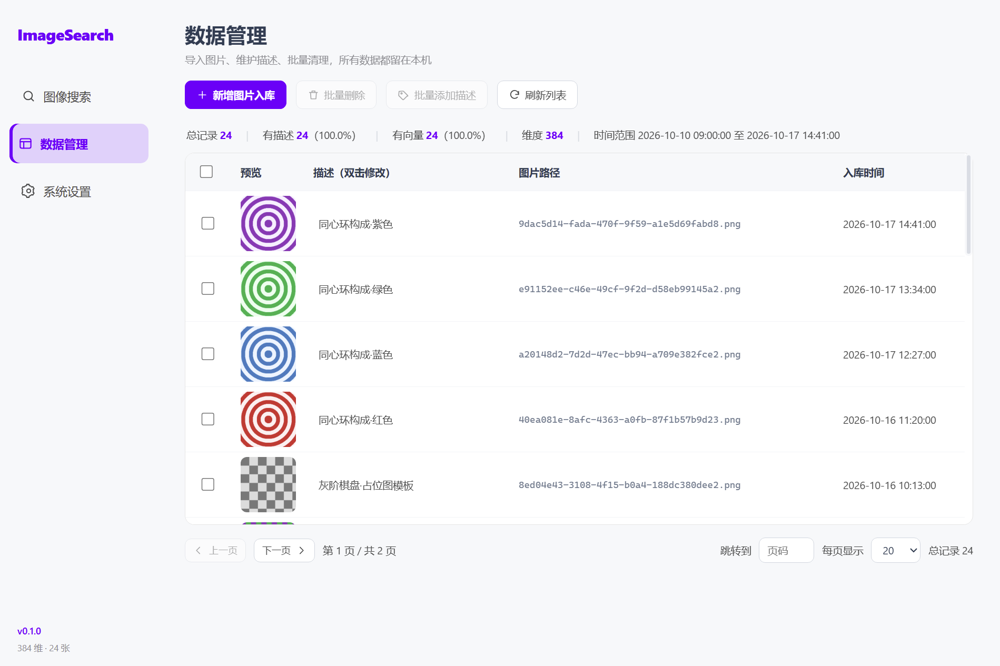
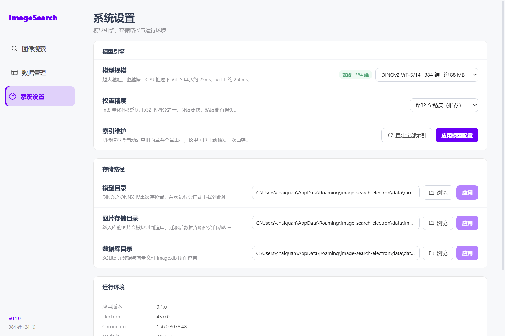

# ImageSearch

一个纯本地的图像检索与图库管理桌面客户端：入库即抽特征，丢一张图进来就能找到相似的那些。

- 特征提取：**DINOv2**（transformers.js + ONNX Runtime，纯 JS，无需 Python / PyTorch）
- 向量检索：**TypeScript 暴力 Top-K**（连续 Float32Array，取代 FAISS）
- 数据存储：**SQLite**（node-sqlite3-wasm，无需本地编译）
- 桌面壳：**Electron 45 + React 19 + Vite**

## 页面







## 技术对照

本项目由最初的 **PyQt5 + Python** 版重写而来，能力一一对应：

| 能力 | 原实现 | 现实现 |
| --- | --- | --- |
| 桌面界面 | PyQt5 + QSS | Electron + React + CSS |
| 特征提取 | `torch.hub` DINOv2 + PyTorch | `@huggingface/transformers` + ONNX Runtime |
| 模型权重 | `.pth` 手动下载 | 自动从镜像拉 ONNX，缓存复用 |
| 向量检索 | FAISS `IndexFlatL2` + `IndexIDMap` | 连续 `Float32Array` + 插入式 Top-K |
| 数据库 | `sqlite3`（Python 内置） | `node-sqlite3-wasm` |
| 图像处理 | Pillow | 模型自带的 `RawImage` / image processor |
| 打包 | PyInstaller | electron-builder（NSIS） |

## 快速开始

```bash
npm install          # 无原生模块，不需要 VS Build Tools
npm run dev          # 开发模式（热更新）
```

生产构建：

```bash
npm run build        # 编译 main / preload / renderer 到 out/
npm start            # 用编译产物启动
npm run dist         # 打 Windows 安装包到 release/
```

首次启动会从 `hf-mirror.com` 下载 DINOv2 ViT-S/14 的 ONNX（约 88 MB），之后走本地缓存。
镜像地址可以在设置页改，或直接改 `settings.json` 里的 `hfMirror`。

## 功能

**图像检索**

- 点击或**拖拽**上传查询图（jpg / png / webp / bmp）
- DINOv2 提取 384 维特征 → 全库 L2 检索 → 4 列结果卡片
- 卡片含：缩略图、描述胶囊、完整路径（点击复制）、匹配度
- 匹配度沿用原算法 `1 / (1 + distance)`，排序与 Python 版一致
- 显示数量 6 / 12 / 24 / 36 / 48，切换自动重搜
- 点图片开大图预览，可直达所在文件夹

**数据管理**

- 批量导入：复制到托管目录（uuid 重命名）→ 抽特征 → 入库 → 实时进索引
- 导入进度弹窗、逐张状态、失败计数
- 分页表格（10 / 20 / 50 / 100、页码跳转），表头吸顶
- 双击描述即改即存；勾选后批量写入同一描述
- 批量删除（库 + 索引 + 物理文件），危险操作二次确认
- 统计条：总数、有描述率、有向量率、维度、入库时间范围

**系统设置**

- 模型规模：ViT-S / ViT-B / ViT-L（384 / 768 / 1024 维）
- 权重精度：fp32 全精度 / int8 量化
- 切换模型自动清空旧向量并全量重扫；也可手动触发重建
- 模型目录 / 图片目录 / 数据库目录迁移（复制 + 配置落盘 + 索引重载）
- 图片目录迁移会同步改写数据库里的路径前缀
- 运行环境信息、一键打开数据目录

## 数据位置

Windows：`%APPDATA%\image-search-electron`

```
settings.json           # 配置
data/
├─ models/              # ONNX 权重缓存
├─ images/              # 托管图片
└─ database/image.db    # 元数据 + 向量 BLOB
```

所有数据都在本地，不联网也能检索（仅首次下载模型需要网络）。

## 命令行参数

```bash
ImageSearch.exe --query "D:\pics\a.jpg"          # 启动即用该图检索
ImageSearch.exe --route=library                   # 启动进指定页（search/library/settings）
ImageSearch.exe --screenshot=out.png --delay=3000 # 自动截图后退出（调试用）
```

## 校验

```bash
npm run verify    # 15 项核心逻辑断言：向量索引 + 路径前缀改写
npm run seed      # 生成 24 张演示图并写入当前数据目录（会清空现有图库）
```

## 相对 Python 版修掉的问题

- 运行期改图片存储目录后，新导入的图仍写进旧目录（原版 `db_page.py` 在模块顶层 import 了路径快照）
- 切到 `vitl14` / `vitg14` 时下载链接为空导致崩溃（原版只有 s14/b14 配了 URL）
- 检索在主线程同步跑推理，界面假死（现在推理在 main 进程，渲染层完全异步）
- 缩略图画布 160×160 但容器高 150，图片被裁
- 启动闪屏图缺失导致显示灰块
- 路径前缀改写把 `_` / `%` 当 LIKE 通配符，可能误改前缀相似的目录
